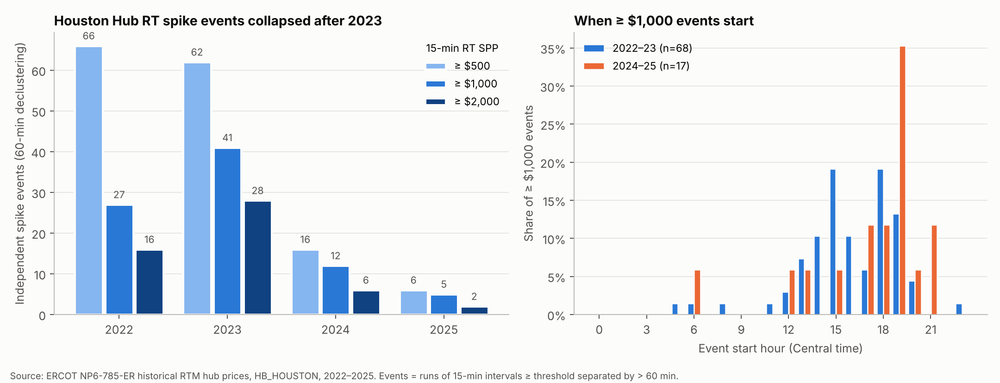
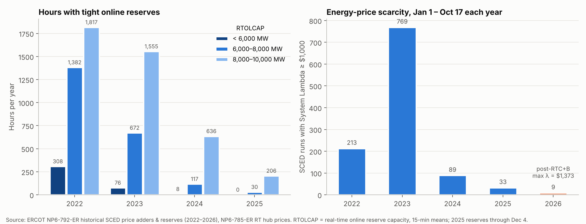
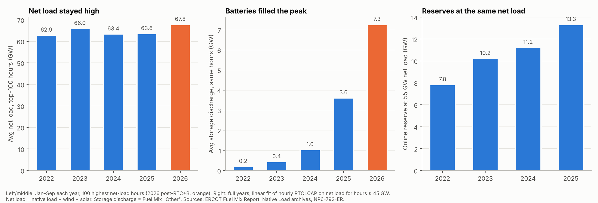
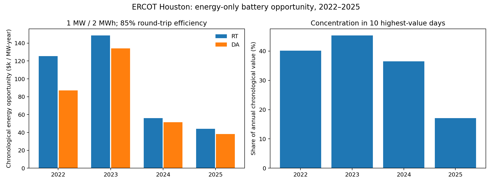

# ERCOT ScarcityLab

**Why did Houston Hub price spikes disappear after 2023, and what did it do to battery economics?**

An empirical study of ERCOT scarcity pricing, 2022–2026, built entirely from official ERCOT archives:
15-minute Houston Hub settlement prices, ~420,000 SCED intervals of reserves and price adders, and system
fuel-mix and load data. The repository prioritises market interpretation and reproducible calculations over model complexity.

## Results at a glance

| Metric | 2023 | 2025 | Interpretation |
|---|---:|---:|---|
| Independent RT spikes ≥ $1,000/MWh | 41 | 5 | Events declustered with a 60-minute gap |
| Online reserve at 55 GW net load, GW | 10.2 | 13.3 | Same demand conditions, more reserve |
| Storage discharge in the 100 tightest hours (Jan–Sep), GW | 0.4 | 3.6 | 7.3 GW in 2026 |
| Mean ORDC adder (RTORPA), $/MWh | 0.93 | 0.014* | Old ORDC mechanism, pre-RTC+B |
| Houston RT chronological battery value, $/MW-year | 148,634 | 43,987 | **−70.4%**, ex-post energy-only opportunity |
| Share of RT battery value earned on the 10 best days | 45.4% | 17.1% | Value moved out of the tail |

*2025 SCED values cover the pre-RTC+B period only (through December 4). All SCED quantities are realized outcomes used to
explain prices, never forecast inputs. Battery figures assume perfect foresight and zero daily start/end state of charge.*

## Findings

1. **Spikes collapsed.** Independent Houston Hub RT events above $1,000/MWh fell from 41 (2023) to 5 (2025); every 2025 event
   lasted 30 minutes or less. The 99.9th percentile of the hourly RT − DA spread fell from $2,727 (2022) to $194 (2025).
2. **Spikes ran mainly through the energy price, not the ORDC adder.** In 77% of spike intervals System Lambda is at least half
   the settlement price; ORDC + reliability adders reach half in only 13%. (Diagnostic subtraction, not a settlement identity.)
3. **Reserves rose while demand kept growing.** Load and peak net load did not fall, yet fitted online reserve at 55 GW net load
   rose from 7.8 GW (2022) to 13.3 GW (2025).
4. **Storage became a large part of peak-hour supply.** Fuel Mix `Other` behaves like battery discharge (see validation below);
   in the 100 tightest net-load hours it rose from 0.2 GW (2022) to 3.6 GW (2025) and 7.3 GW (2026), as the tightest hours moved
   to 19:00–20:00. Storage does not explain the 2022→2023 reserve step, which remains unexplained here.
5. **Remaining spikes are no longer system-tightness events.** 2022–23 spike hours sat at the 98–99th net-load percentile;
   2024–25 spike hours at the 86–88th, with ~12 GW of online reserve in 2025.
6. **Battery arbitrage value fell ~70% after 2023, almost entirely in the tail.** The median daily spread stayed at $37–58/MWh;
   the share of annual value earned on the 10 best days fell from 45% to 17%. This is consistent with storage cannibalising the
   scarcity events that paid it, but price data alone cannot prove that causal link.
7. **Post-RTC+B (Dec 5, 2025 onward):** Jan–Oct 2026 had the tightest net load in the sample but a maximum System Lambda of
   $1,373, versus ~$5,000 in every prior year. Storage growth and the market redesign coincide, so they cannot be separated here.

### Spikes



### Reserves and energy-price scarcity



### Net load, storage and reserves



**Is Fuel Mix `Other` really storage?** ERCOT does not label it as such, so it was tested against WSL (storage charging load):

| | 2022 | 2023 | 2024 | 2025 | 2026* |
|---|---:|---:|---:|---:|---:|
| `Other` energy ÷ storage charging energy | 0.86 | 0.81 | 0.83 | 0.83 | 0.85 |

The ratio sits at battery round-trip efficiency every year, the daily profiles are mirror images (charging 08:00–11:00,
discharge 06:00–07:00 and 17:00–21:00), and daily discharge and charging energy correlate at 0.93 (2024 onward).
`Other` is therefore treated as storage discharge, with small non-storage output possible. Discharge is a lower bound on
storage's contribution to reserves, because idle battery headroom also counts as online reserve. (*2026 = Jan–Sep.)

### Battery energy-only opportunity



**Two separate measures.** Daily TB2 (mean of the two highest minus the two lowest hourly prices, $/MWh) is a price-spread
measure that ignores chronology. The **chronological battery value** comes from a time-ordered dynamic program: hourly prices,
1 MW / 2 MWh, 85% round-trip efficiency, 0.125 MWh state-of-charge grid, zero start/end state of charge each local day, no
simultaneous charge and discharge. It assumes perfect foresight and omits ancillary services, bidding restrictions, degradation,
fees and price impact, so it is an **ex-post energy-only opportunity**, not real profit or a tradable backtest.

## What this tells a trader

- Scarcity value in ERCOT moved from a handful of extreme days to a thin daily spread; tail-dependent strategies and assets
  priced on 2022–23 history are mispriced against the current regime.
- The remaining spikes are short and happen at moderate net load, so they look more like ramp, outage or local events than
  system-wide shortage; DA price ranking already captures most of the risky hours (53–80% of spike hours fall in the day's top-3 DA hours).
- Storage is now the marginal evening resource. Its own growth is a first-order input for any ERCOT price or battery-revenue view.

## Scope and limits

- **Explanatory, not predictive.** Reserves, adders and System Lambda are realized SCED outcomes and are not used as forecast features.
- Fixed-net-load reserve comparisons are descriptive regressions; weather, outages, thermal fleet and interconnection are not controlled.
- Associations between storage growth, reserves and the disappearance of spikes are not causal estimates.
- 2026 real-time settlement prices have no annual archive yet; 2026 is analysed through System Lambda and fuel mix only.
- No claim of out-of-sample trading alpha is made.

## Replication

```bash
python -m pip install -r requirements.txt
python -m pytest -q
```

Raw ERCOT workbooks are not redistributed and `data/` is Git-ignored, so a clean checkout reviews the tracked `results/`
but cannot regenerate them without downloading the sources. Step-by-step commands: [`docs/REPRODUCIBILITY.md`](docs/REPRODUCIBILITY.md).

## Primary sources

| Official dataset | Coverage used |
|---|---|
| ERCOT NP6-785-ER, RT hub/load-zone settlement prices (15-min) | 2022–2025 |
| ERCOT NP4-180-ER, DAM hub/load-zone settlement prices (hourly) | 2022–2025 |
| ERCOT NP6-792-ER, historical SCED price adders and reserves | 2022–2026, old and RTC+B formats |
| ERCOT Fuel Mix Report (IntGenbyFuel) and Native Load archives | 2022 – Sep 2026 |

Field notes and data-quality issues: [`docs/OFFICIAL_DATA_PRODUCTS.md`](docs/OFFICIAL_DATA_PRODUCTS.md).
Full tables and caveats: [`docs/AUDIT_FINDINGS.md`](docs/AUDIT_FINDINGS.md).

## Repository layout

- `scripts/` — ERCOT importers, price audit, reserve/adder analysis, net-load analysis, storage-proxy validation, battery valuation
- `tests/` — battery dispatch, DST and storage-proxy checks
- `results/` — tables, reports and charts (no raw ERCOT data)
- `docs/` — findings, reproducibility, data provenance
- `forecasting_scaffold/` — separate point-in-time forecasting pipeline, tested on **synthetic data only**; not evidence about ERCOT
